# Catalog

This folder holds rendered images of the objects, the materials, and the scenes of the game. A program makes the images and this file. Do not change them by hand.

Each entry sets its camera, pose, game time, seed, and light to fixed values. The same program on the same computer writes the same bytes each time.

## Make the images

| Task | Command |
| --- | --- |
| Render all entries | `cargo run --release -p voidwright-client --bin catalog` |
| Render some entries | `cargo run --release -p voidwright-client --bin catalog -- wanderer material-island` |

The program renders the entries with names that start with one of the given words. With no words, it renders all entries and removes the images that no entry uses. It always writes this file again.

## Add an entry

1. Open `crates/client/src/catalog/entries.rs`.
2. Add an `Entry::new` item to the list of its group, for example `wanderer_views()` or `world_views()`. Give a name, a description, a subject, and a camera. For a new group, add a function with its list, and add one line for it in `entries()`.
3. Render the new entry with the command above.
4. Commit the new image and this file.

The name is also the file name of the image. Use lowercase letters, digits, and hyphens.

| Subject | Image |
| --- | --- |
| `Subject::Wanderer { gait, time }` | The wanderer on the stage of the model inspector. The coat moves for 2 seconds before `time`. The lantern lights the figure. |
| `Subject::Swatch(material)` | A ball and a flat patch of the material in the light of Vael. |
| `Subject::Ground(color)` | A ball and a flat patch of an island color. The light is baked into the color, as on the island. |
| `Subject::Surface(kind)` | A grey patch with the detail surface, close. |
| `Subject::World { seed, time, walk }` | The game world as the game draws it, at the game time. `walk` is a tile offset that the player walks to. |

The camera turns around a target. `Camera::new([width, height])` sets the size of the image in pixels. `.at(focus, offset)` sets the target: `Focus::Origin`, `Focus::Player`, or `Focus::Bone(bone)`, and an offset in meters. `.orbit(yaw, pitch, distance)` sets the angles in radians and the distance in meters. The angles are the same as the angles of `--orbit`.

Each material constant (`const NAME: Material` at the top level of a module) must have an entry. A test finds the constants in the source code. Add a new constant to the `MATERIALS` list of its module. For a new module, add a `pub const MATERIALS` list to the module and a `materials(...)` line to `entries()`.

The game draws its world with all its objects. For an object in the world, add a `world(...)` item to `world_views()` with a camera on the object. No new code is necessary. For a new kind of subject, add a `Subject` kind in `crates/client/src/catalog/mod.rs` and its draw step in `crates/client/src/catalog/app.rs`. A mesh with a new shader also needs a `Model` kind and a draw call in `crates/client/src/catalog/studio.rs`.

Keep each image to 640 × 640 pixels or fewer in total, and keep the folder below 15 MB. Tests check these limits.

## Entries

| Name | Shows | Image |
| --- | --- | --- |
| `wanderer-front` | The wanderer at idle, from the front. | 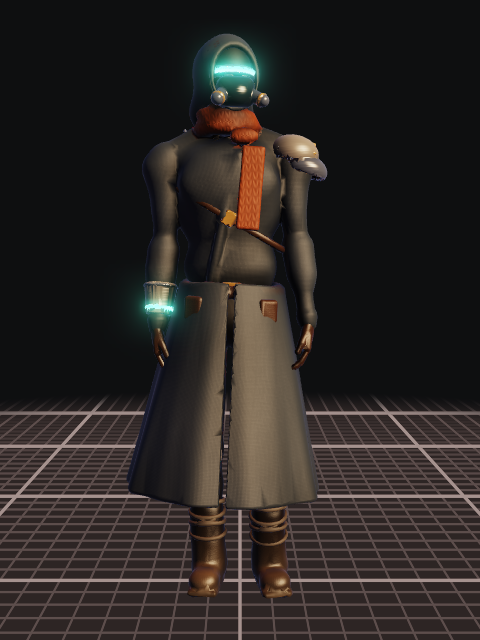 |
| `wanderer-left` | The wanderer at idle, from the left side. | 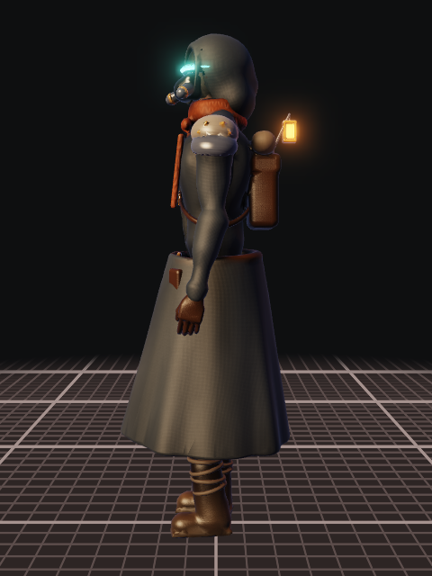 |
| `wanderer-back` | The wanderer at idle, from the back. | 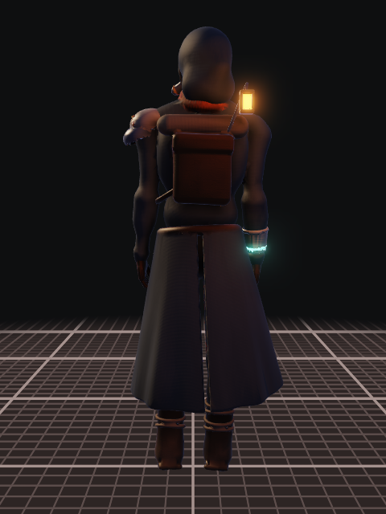 |
| `wanderer-right` | The wanderer at idle, from the right side. | 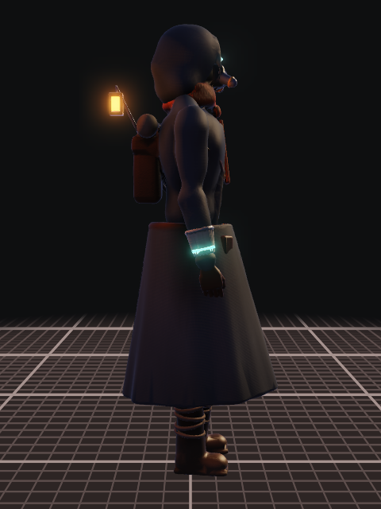 |
| `wanderer-three-quarter` | The wanderer at idle, from the front left and a little above. | 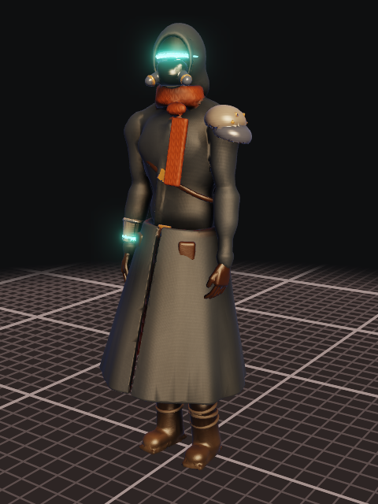 |
| `wanderer-walk-contact` | The wanderer walks. The front heel touches the ground. | 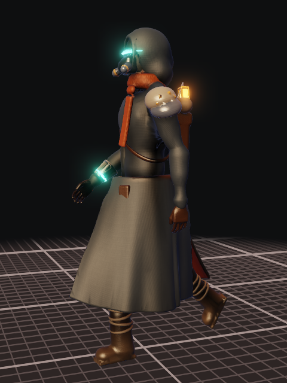 |
| `wanderer-walk-passing` | The wanderer walks. One leg passes the other. | 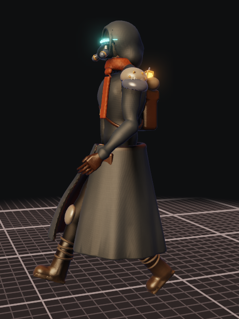 |
| `wanderer-run-contact` | The wanderer runs. The front foot touches the ground. | 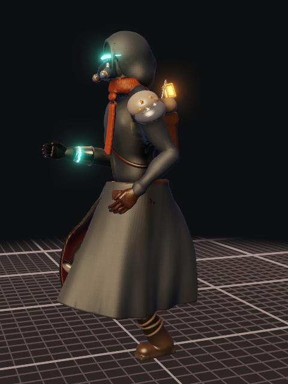 |
| `wanderer-run-flight` | The wanderer runs. Both feet are off the ground. | 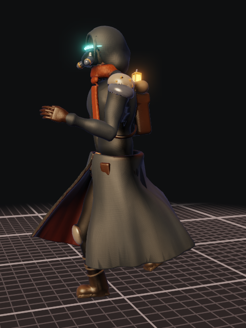 |
| `wanderer-head` | The head, the visor, and the mask, close. | 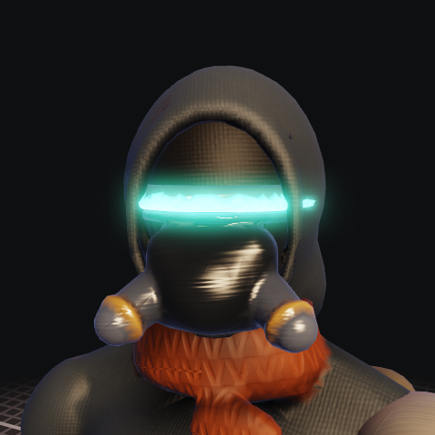 |
| `wanderer-hand-left` | The left glove, close, from the outside. | 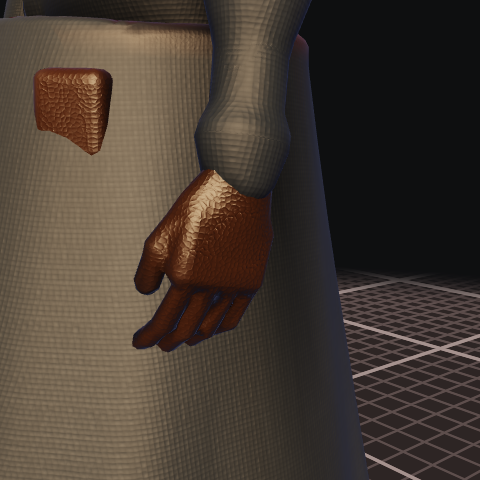 |
| `wanderer-hand-right` | The right glove and the teal armband, close, from the outside. | 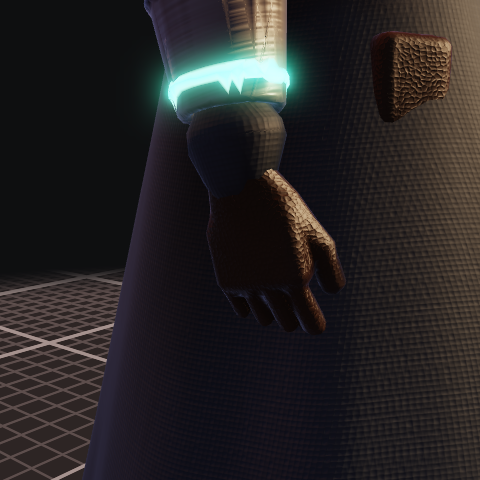 |
| `wanderer-boots` | The boots and the leg wraps, close. | 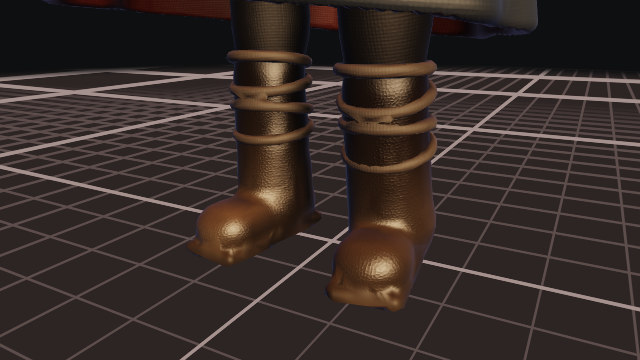 |
| `material-wanderer-coat` | Material COAT of the wanderer: color 0.22 0.24 0.25, shine 0.06, glow 0.0, woven surface. A ball and a flat patch in the light of Vael. | 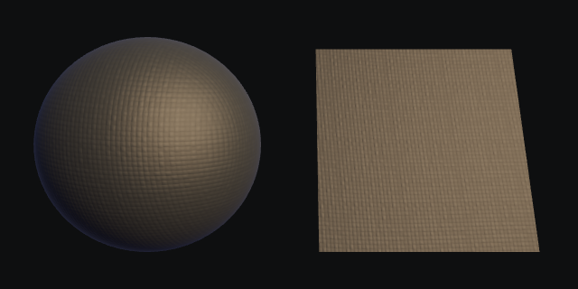 |
| `material-wanderer-lining` | Material LINING of the wanderer: color 0.30 0.12 0.09, shine 0.05, glow 0.0, woven surface. A ball and a flat patch in the light of Vael. | 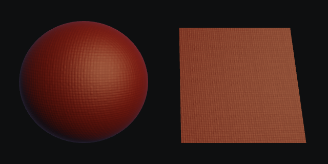 |
| `material-wanderer-cloth` | Material CLOTH of the wanderer: color 0.14 0.13 0.12, shine 0.05, glow 0.0, woven surface. A ball and a flat patch in the light of Vael. | 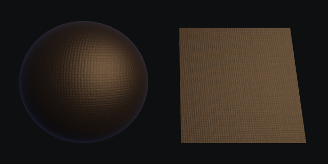 |
| `material-wanderer-scarf` | Material SCARF of the wanderer: color 0.50 0.26 0.12, shine 0.05, glow 0.0, knitted surface. A ball and a flat patch in the light of Vael. | 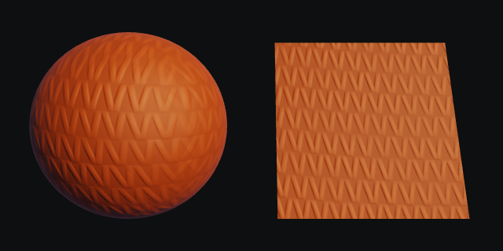 |
| `material-wanderer-leather` | Material LEATHER of the wanderer: color 0.24 0.16 0.10, shine 0.18, glow 0.0, grained surface. A ball and a flat patch in the light of Vael. | 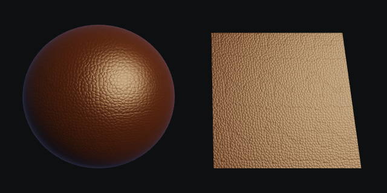 |
| `material-wanderer-wrap` | Material WRAP of the wanderer: color 0.36 0.32 0.26, shine 0.04, glow 0.0, woven surface. A ball and a flat patch in the light of Vael. | 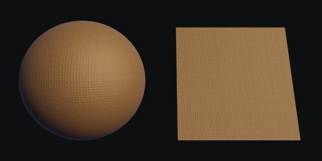 |
| `material-wanderer-boot` | Material BOOT of the wanderer: color 0.15 0.11 0.08, shine 0.20, glow 0.0, grained surface. A ball and a flat patch in the light of Vael. | 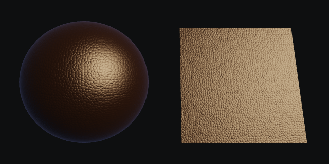 |
| `material-wanderer-sole` | Material SOLE of the wanderer: color 0.05 0.05 0.05, shine 0.05, glow 0.0, smooth surface. A ball and a flat patch in the light of Vael. | 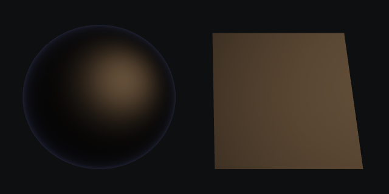 |
| `material-wanderer-plate` | Material PLATE of the wanderer: color 0.46 0.44 0.40, shine 0.40, glow 0.0, brushed surface. A ball and a flat patch in the light of Vael. | 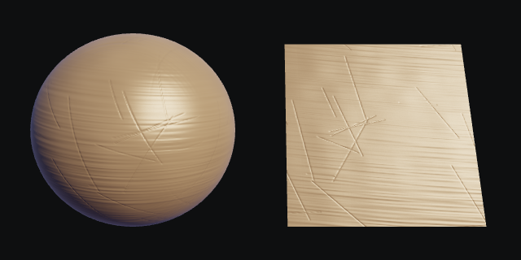 |
| `material-wanderer-metal` | Material METAL of the wanderer: color 0.30 0.32 0.35, shine 0.65, glow 0.0, brushed surface. A ball and a flat patch in the light of Vael. | 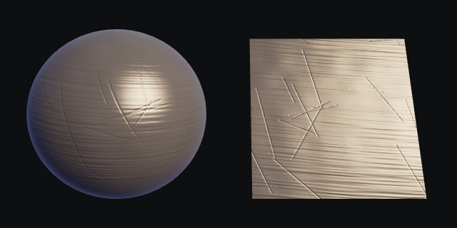 |
| `material-wanderer-mask` | Material MASK of the wanderer: color 0.13 0.14 0.15, shine 0.55, glow 0.0, brushed surface. A ball and a flat patch in the light of Vael. | 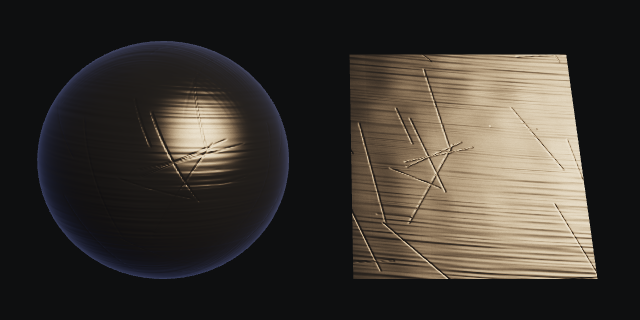 |
| `material-wanderer-brass` | Material BRASS of the wanderer: color 0.55 0.42 0.22, shine 0.70, glow 0.0, brushed surface. A ball and a flat patch in the light of Vael. | 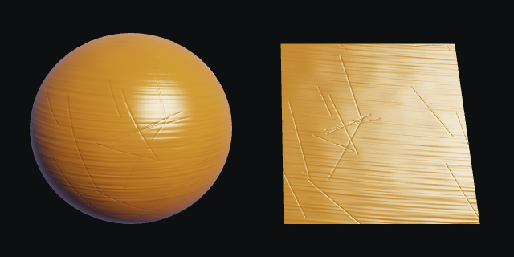 |
| `material-wanderer-teal-light` | Material TEAL_LIGHT of the wanderer: color 0.30 1.00 0.85, shine 0.00, glow 3.0, smooth surface. A ball and a flat patch in the light of Vael. | 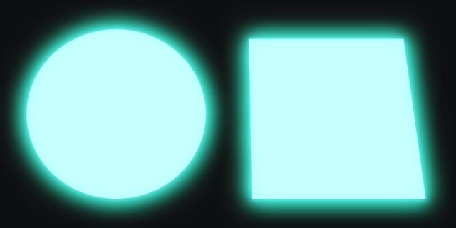 |
| `material-wanderer-amber-light` | Material AMBER_LIGHT of the wanderer: color 1.00 0.60 0.25, shine 0.00, glow 3.0, smooth surface. A ball and a flat patch in the light of Vael. | 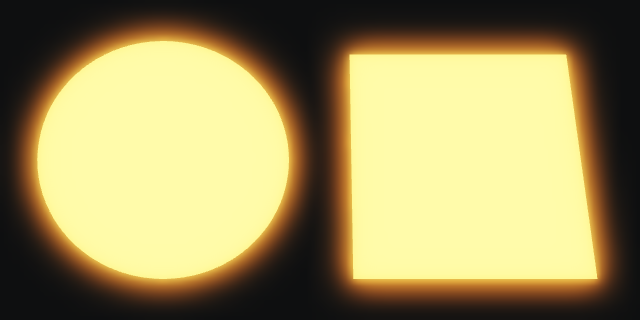 |
| `surface-woven` | The woven detail surface on a grey patch, close. | 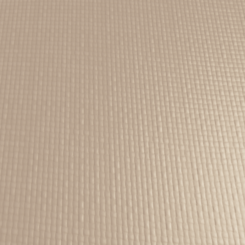 |
| `surface-knitted` | The knitted detail surface on a grey patch, close. | 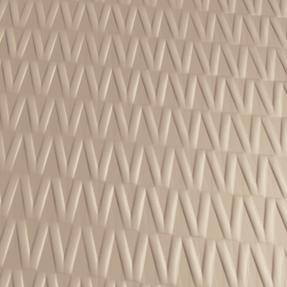 |
| `surface-grained` | The grained detail surface on a grey patch, close. | 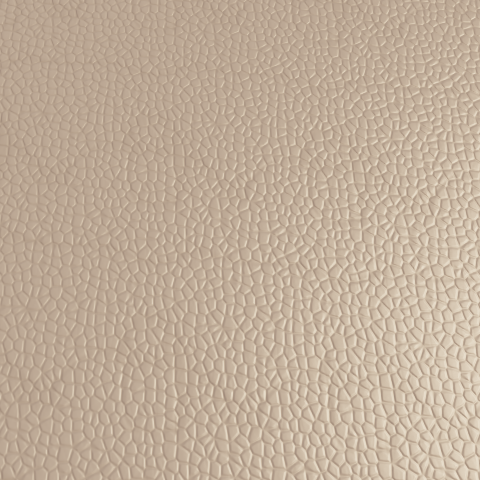 |
| `surface-brushed` | The brushed detail surface on a grey patch, close. | 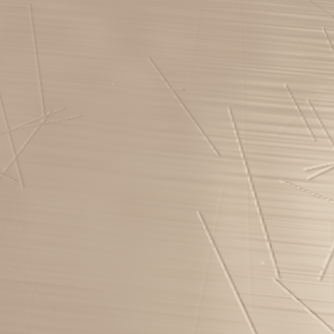 |
| `material-island-moss-dark` | Island color MOSS_DARK: color 0.11 0.20 0.19, with the light of Vael baked in as on the island. A ball and a flat patch. | 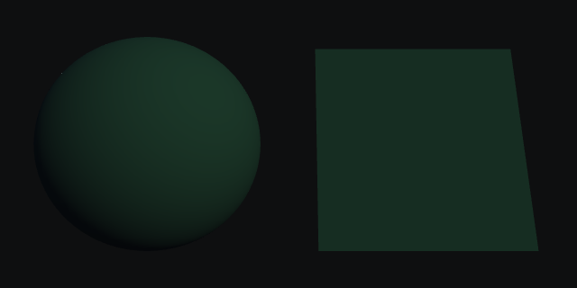 |
| `material-island-moss-light` | Island color MOSS_LIGHT: color 0.22 0.33 0.29, with the light of Vael baked in as on the island. A ball and a flat patch. | 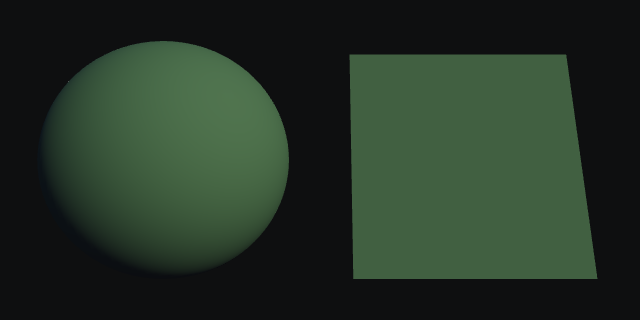 |
| `material-island-soil` | Island color SOIL: color 0.23 0.18 0.16, with the light of Vael baked in as on the island. A ball and a flat patch. | 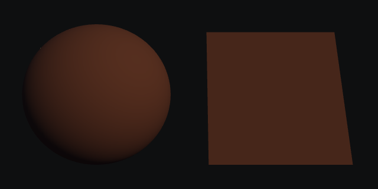 |
| `material-island-bloom` | Island color BLOOM: color 0.30 0.41 0.36, with the light of Vael baked in as on the island. A ball and a flat patch. | 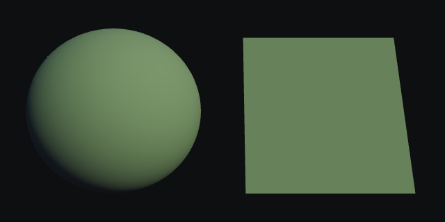 |
| `material-island-rock` | Island color ROCK: color 0.36 0.34 0.36, with the light of Vael baked in as on the island. A ball and a flat patch. | 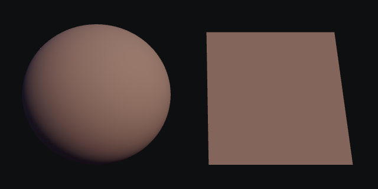 |
| `material-island-cliff` | Island color CLIFF: color 0.30 0.27 0.28, with the light of Vael baked in as on the island. A ball and a flat patch. | 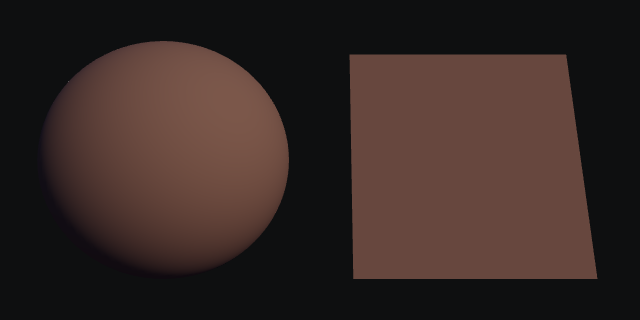 |
| `material-island-underside` | Island color UNDERSIDE: color 0.22 0.21 0.24, with the light of Vael baked in as on the island. A ball and a flat patch. |  |
| `island-wide` | The whole island in the void, from above. | 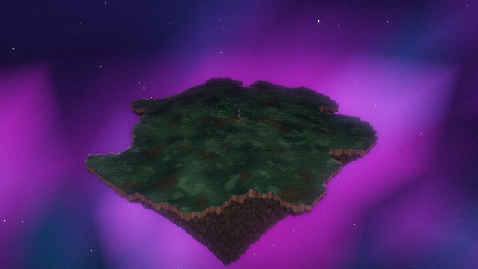 |
| `island-ground` | The ground near the wanderer, close: moss, soil, rock, and spores. | 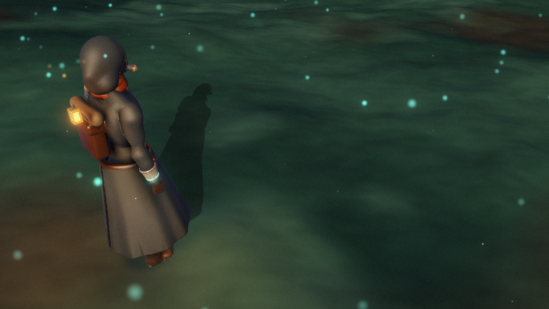 |
| `island-below` | The island from below: the cliffs and the underside. | 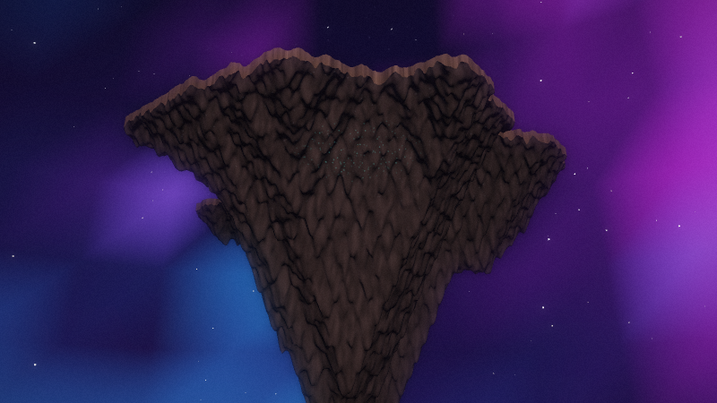 |
| `island-walk` | The wanderer walks to a marked tile. | 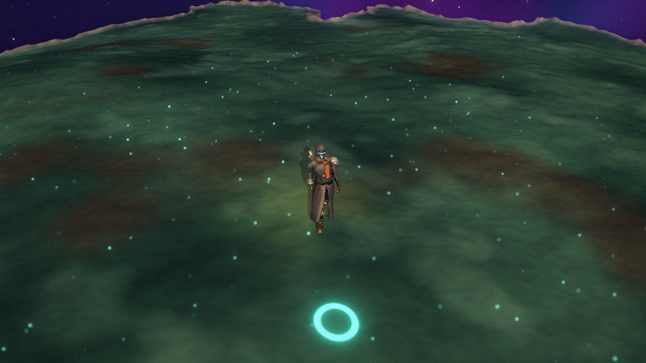 |
| `sky-vael` | The sky toward the star Vael. | 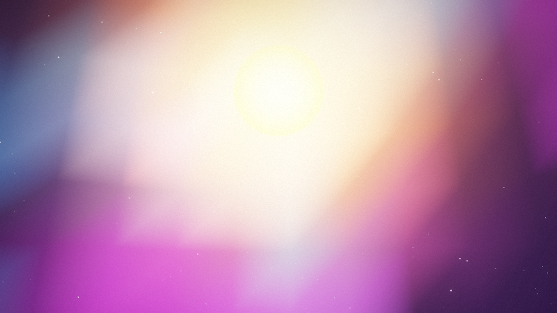 |
| `sky-nebula` | The sky away from Vael, with the nebula. | 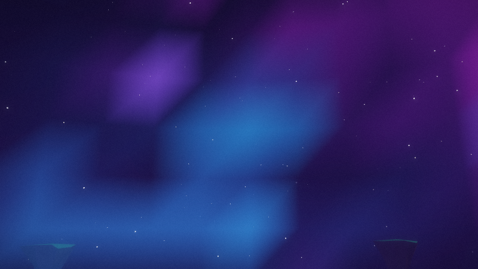 |
